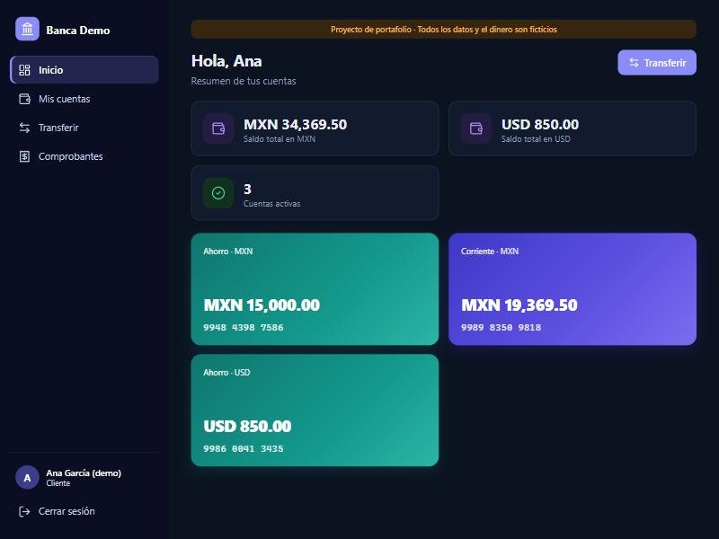
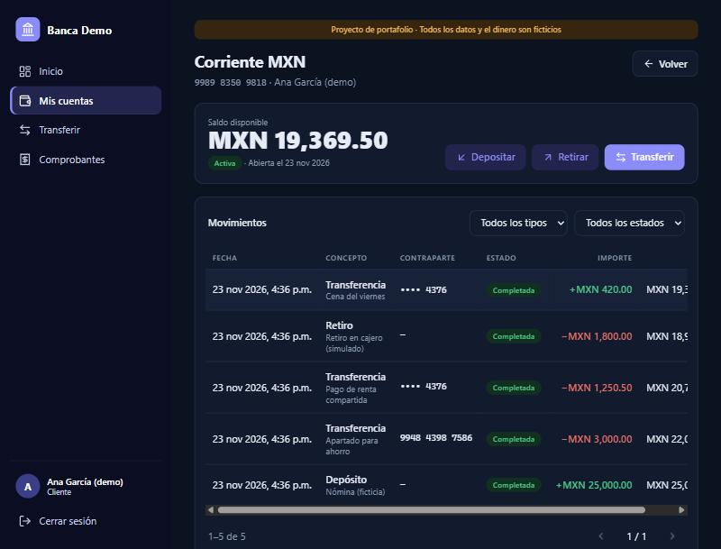
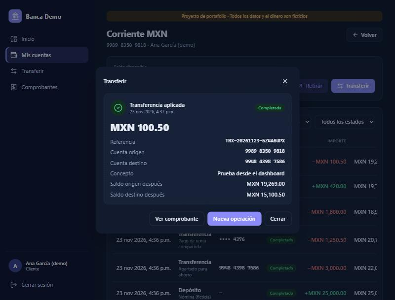
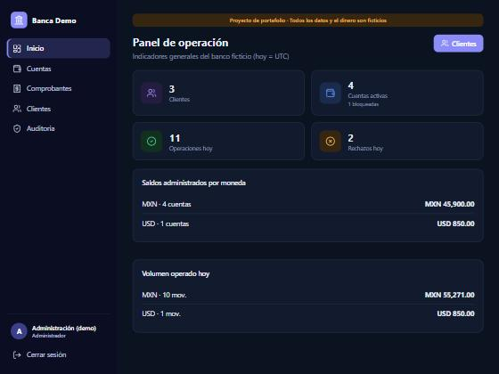
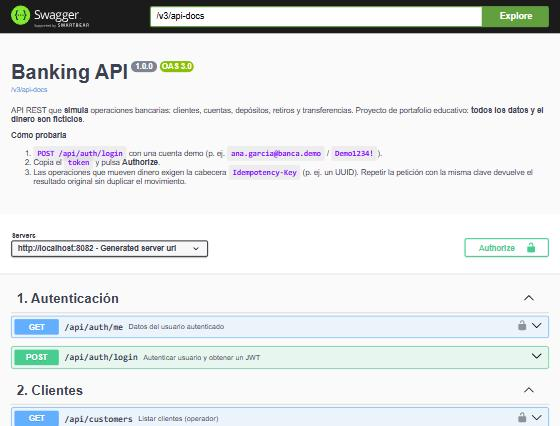
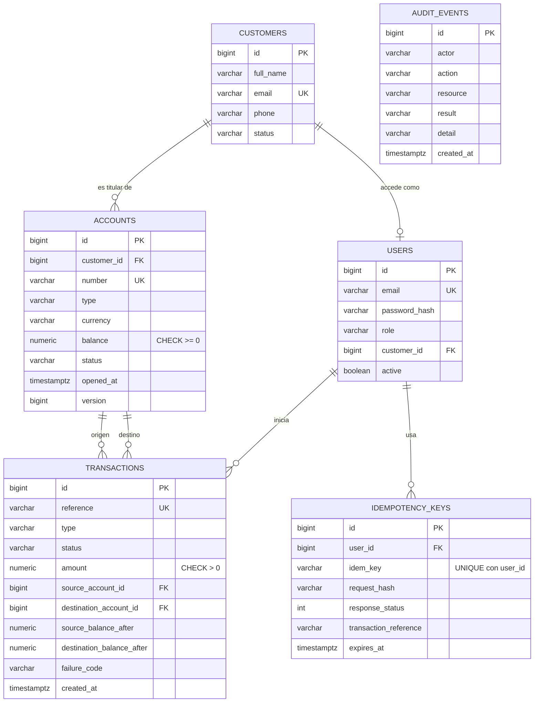

# API Bancaria (Banking API)

API REST que **simula** operaciones bancarias entre clientes y cuentas: alta de clientes, apertura de cuentas,
depósitos, retiros y transferencias, con historial inmutable, idempotencia, control de concurrencia y auditoría.
Incluye un dashboard web opcional para clientes y operadores.

> ⚠️ **Proyecto de portafolio educativo.** No es un sistema bancario real ni apto para dinero real.
> Todos los clientes, cuentas, teléfonos e importes son **ficticios**.

> El valor del proyecto no está en el CRUD, sino en la **consistencia del dinero**: cada operación es atómica,
> un saldo nunca queda negativo, dos peticiones simultáneas no pueden gastar el mismo saldo y un reintento
> nunca duplica una transferencia.

**Stack:** Java 17/21 · Spring Boot 3.3 · Spring Security (JWT) · Spring Data JPA · Bean Validation · Flyway ·
PostgreSQL / H2 · springdoc-openapi (Swagger) · JUnit 5 · React 18 + TypeScript + Vite · Docker Compose · GitHub Actions

---

## Funcionalidades

- **Clientes** ficticios con usuario de acceso; los operadores los dan de alta, bloquean y desbloquean.
- **Cuentas** con número único generado (`99` + 10 dígitos, prefijo que las marca como ficticias), tipo
  ahorro/corriente, moneda (MXN, USD, EUR), saldo y estado (activa, bloqueada, cerrada).
- **Depósitos y retiros** simulados con validación de importe y de estado de la cuenta y del cliente.
- **Transferencias** con débito y crédito atómicos entre cuentas distintas, activas y de la misma moneda.
- **Historial inmutable** paginado por cuenta (incluye los intentos rechazados, con su motivo).
- **Comprobantes**: consulta del resultado de cualquier operación por su referencia (`TRX-20261123-K7Q2M9XA`).
- **Idempotencia** obligatoria en las operaciones de dinero (`Idempotency-Key`).
- **Autenticación JWT y roles**: cliente, operador y administrador, con propiedad de recursos.
- **Auditoría**: logins, altas, cambios de estado y operaciones (exitosas, rechazadas y denegadas), sin secretos.
- **Swagger UI** con autorización por token y **colección Postman** con casos de éxito y error.
- **Dashboard web** (opcional según la guía): saldos, cuentas, movimientos, transferencias, panel de operador y auditoría.

## Capturas

| Dashboard del cliente | Historial de una cuenta |
|---|---|
|  |  |

| Comprobante de transferencia | Panel del operador | Swagger UI |
|---|---|---|
|  |  |  |

---

## Arquitectura

```mermaid
flowchart LR
    U[Navegador / Swagger / Postman] --> FE[Dashboard React<br/>Nginx en Docker · Vite en desarrollo]
    U -->|JWT Bearer| API
    FE -->|/api + JWT + Idempotency-Key| API[API REST Spring Boot]
    subgraph Backend
      API --> SEC[Spring Security<br/>JWT HS256 · roles · AccessPolicy]
      API --> CTRL[Controllers + Bean Validation]
      CTRL --> OPS[OperationService<br/>idempotencia y rechazos]
      OPS --> LEDGER[LedgerService<br/>@Transactional · SELECT FOR UPDATE]
      CTRL --> SVC[Customer/Account/Report/Audit services]
      LEDGER --> REPO[Repositories<br/>Spring Data JPA]
      SVC --> REPO
    end
    REPO --> DB[(PostgreSQL<br/>migraciones Flyway)]
```

Paquetes del backend (`com.portafolio.banca`): `config`, `controller`, `dto`, `entity`, `exception`, `mapper`,
`repository`, `security`, `service`, `validation`.

### Modelo de datos (ERD)



El esquema completo, con sus restricciones `CHECK`, está en
[`V1__schema.sql`](backend/src/main/resources/db/migration/V1__schema.sql).

---

## Reglas de negocio y cómo se garantizan

| Regla | Implementación |
|---|---|
| Importe estrictamente positivo, máx. 2 decimales, sin `float/double` | `BigDecimal` + `NUMERIC(19,2)`; anotación `@ValidAmount` (`> 0`, `≤ 1,000,000.00`, 2 decimales); `CHECK (amount > 0)` |
| El saldo nunca es negativo (no se modela sobregiro) | Validación de fondos → `422 INSUFFICIENT_FUNDS`; `Account.debit()` protege el invariante; `CHECK (balance >= 0)` en la base |
| Origen ≠ destino, ambas activas, misma moneda | `SAME_ACCOUNT`, `ACCOUNT_NOT_ACTIVE`, `DESTINATION_NOT_ACTIVE`, `CUSTOMER_BLOCKED`, `CURRENCY_MISMATCH` (no hay conversión de divisas) |
| Débito y crédito atómicos | `LedgerService` ejecuta bloqueo, validaciones, débito, crédito, movimiento, auditoría e idempotencia en **una** transacción; cualquier fallo revierte todo |
| Sin doble gasto | `SELECT … FOR UPDATE` (bloqueo pesimista) sobre las cuentas; en transferencias se bloquean en orden de id para evitar interbloqueos; `@Version` como segunda barrera |
| Reintentos no repiten el movimiento | `Idempotency-Key` obligatoria; la clave se guarda en la misma transacción que el movimiento con `UNIQUE(user_id, idem_key)` |
| Historial inmutable | `@Immutable`, sin setters; la API solo inserta. Los rechazos se registran como movimientos `REJECTED` sin tocar saldos |
| Cliente solo ve y opera lo suyo | `AccessPolicy`: cuentas ajenas responden **404** (no revela qué ids existen); operadores consultan todo pero **no mueven fondos** (403) |
| Sin datos sensibles | Sin CVV, tarjetas ni credenciales bancarias; contraseñas con BCrypt; logs y auditoría con cuentas enmascaradas (`•••• 1234`) y sin tokens |

### Idempotencia en detalle

1. El cliente envía `Idempotency-Key: <uuid>` en `POST /deposits`, `/withdrawals` y `/transfers`.
2. Si la clave ya existe para ese usuario **con la misma petición** (huella SHA-256 de operación, cuentas, importe
   y concepto), se devuelve el resultado original con `Idempotent-Replayed: true` — también si fue un rechazo.
3. Si existe **con otra petición** → `409 IDEMPOTENCY_KEY_REUSED`.
4. Si dos peticiones con la misma clave llegan a la vez, la segunda choca con la restricción única, su transacción
   (incluido el movimiento) se revierte por completo y recibe el resultado de la primera.
5. Las claves caducan a las 24 h (`IDEMPOTENCY_TTL_HOURS`) y una tarea programada las purga.

El dashboard genera una clave por operación y la **reutiliza** si el usuario reintenta tras un error de red.

### Respuestas de error

Todas siguen el mismo formato:

```json
{
  "timestamp": "2026-11-23T22:37:12Z",
  "status": 422,
  "error": "Unprocessable Entity",
  "code": "INSUFFICIENT_FUNDS",
  "message": "Saldo insuficiente: disponible 749.75 MXN",
  "path": "/api/accounts/1/withdrawals",
  "reference": "TRX-20261123-M52HC7DD"
}
```

`400` validación · `401` sin sesión · `403` sin permiso por rol · `404` inexistente o ajeno · `409` conflicto
(email duplicado, clave reutilizada, modificación concurrente) · `422` regla de negocio · `500` error inesperado
(la operación no se aplica).

---

## API

| Método | Ruta | Quién | Responsabilidad |
|---|---|---|---|
| POST | `/api/auth/login` | Público | Obtener JWT |
| GET | `/api/auth/me` | Autenticado | Usuario actual |
| POST | `/api/customers` | Operador | Crear cliente de prueba (y su usuario) |
| GET | `/api/customers` | Operador | Listar / buscar clientes (paginado) |
| GET | `/api/customers/{id}` | Operador o el propio cliente | Consultar cliente |
| PATCH | `/api/customers/{id}/status` | Operador | Bloquear / desbloquear |
| POST | `/api/accounts` | Cliente u operador | Abrir cuenta |
| GET | `/api/accounts` | Autenticado | Listar cuentas (el cliente solo ve las suyas) |
| GET | `/api/accounts/{id}` | Titular u operador | Consultar cuenta y saldo |
| GET | `/api/accounts/{id}/transactions` | Titular u operador | Historial paginado (filtros `type`, `status`) |
| POST | `/api/accounts/{id}/deposits` | Titular | Simular depósito · `Idempotency-Key` |
| POST | `/api/accounts/{id}/withdrawals` | Titular | Simular retiro · `Idempotency-Key` |
| PATCH | `/api/accounts/{id}/status` | Operador | Bloquear, desbloquear o cerrar (cerrar exige saldo 0) |
| POST | `/api/transfers` | Titular de la cuenta origen | Transferir · `Idempotency-Key` |
| GET | `/api/transactions/{reference}` | Participante u operador | Resultado de una operación |
| GET | `/api/reports/summary` | Operador | Indicadores generales |
| GET | `/api/audit-events` | Administrador | Bitácora de auditoría |

Documentación interactiva: **Swagger UI** en `/swagger-ui.html` (OpenAPI en `/v3/api-docs`).
Colección Postman: [`postman/banca-api.postman_collection.json`](postman/banca-api.postman_collection.json)
(flujo completo + casos de error, con aserciones para el Collection Runner).

### Cuentas de demostración (ficticias)

Contraseña de todas: `Demo1234!` (configurable con `DEMO_PASSWORD`).

| Usuario | Rol | Datos semilla |
|---|---|---|
| `ana.garcia@banca.demo` | Cliente | 3 cuentas (2 MXN, 1 USD) con movimientos y 1 rechazo |
| `luis.perez@banca.demo` | Cliente | 1 cuenta MXN con movimientos y 1 rechazo |
| `carla.ruiz@banca.demo` | Cliente | 1 cuenta MXN **bloqueada** |
| `operador@banca.demo` | Operador | — |
| `admin@banca.demo` | Administrador | — |

Los datos semilla se cargan solo si la base está vacía y pasan por los mismos servicios que la API (no se
escriben saldos a mano).

---

## Cómo ejecutarlo

### Opción A — Docker Compose (PostgreSQL + API + dashboard)

Requisitos: Docker y Docker Compose.

```bash
cp .env.example .env        # edita DB_PASSWORD y JWT_SECRET
docker compose up --build
```

- Dashboard: http://localhost:3000
- API y Swagger: http://localhost:8080/swagger-ui.html

### Opción B — Local para desarrollo (H2 en memoria, sin instalar base de datos)

Requisitos: Java 17 o 21 y Node 20+.

```bash
# Backend (perfil "local" con H2 en memoria y datos demo) → http://localhost:8080
cd backend
./mvnw spring-boot:run          # Windows: mvnw.cmd spring-boot:run

# Frontend → http://localhost:5173 (redirige /api al backend)
cd frontend
npm ci
npm run dev
```

Para usar otro puerto del backend: `PORT=8082` y en el frontend `VITE_API_PROXY=http://localhost:8082`.
La consola H2 está en `/h2-console` (JDBC URL `jdbc:h2:mem:banca`, usuario `sa`).

### Variables de entorno

| Variable | Descripción | Por defecto |
|---|---|---|
| `SPRING_PROFILES_ACTIVE` | `local` (H2) o `prod` (PostgreSQL) | `local` |
| `DB_URL`, `DB_USERNAME`, `DB_PASSWORD` | Conexión PostgreSQL (perfil `prod`) | — |
| `JWT_SECRET` | Clave HMAC de los JWT (≥ 32 caracteres) | solo para desarrollo |
| `JWT_EXPIRATION_MINUTES` | Vigencia del token | `120` |
| `IDEMPOTENCY_TTL_HOURS` | Vigencia de las Idempotency-Key | `24` |
| `CORS_ALLOWED_ORIGINS` | Orígenes permitidos, separados por coma | `http://localhost:5173,http://localhost:5174` |
| `SEED_DEMO_DATA`, `DEMO_PASSWORD` | Datos ficticios de demostración | `true`, `Demo1234!` |

Nunca subas `.env` al repositorio (está en `.gitignore`).

---

## Pruebas

```bash
cd backend
./mvnw verify
```

20 pruebas (integración con MockMvc + H2, y unitarias de dominio) que cubren **todas** las pruebas mínimas de
aceptación de la guía:

| Prueba de la guía | Test |
|---|---|
| Depósito aumenta saldo y crea movimiento | `depositIncreasesBalanceAndCreatesMovement` |
| Retiro válido disminuye saldo; retiro mayor al saldo se rechaza | `withdrawalRules` |
| Transferencia debita y acredita exactamente el mismo importe | `transferMovesExactAmount` |
| Error durante la transferencia → rollback total | `transferFailureRollsBackEverything` (falla tras escribir débito y crédito) |
| Dos retiros concurrentes no gastan el mismo saldo | `concurrentWithdrawalsCannotDoubleSpend` (6 hilos) y `crossTransfersKeepTotal` |
| Misma Idempotency-Key no duplica la operación | `sameIdempotencyKeyDoesNotDuplicate`, `rejectionIsReplayed`, `concurrentSameKeyProducesOneMovement` |
| Un usuario no consulta ni mueve dinero de cuentas ajenas | `ownershipIsEnforced`, `rolesAreEnforced` |
| Importes negativos, cero, precisión y cuentas bloqueadas | `validatesAmounts`, `transferRules`, `closingAccount` |
| Criterio de proyecto completo (sección 10) | `EndToEnd.fullFlow` |

El pipeline de GitHub Actions ([`ci.yml`](.github/workflows/ci.yml)) ejecuta las pruebas del backend con Java 21
y el type-check + build del frontend.

---

## Decisiones técnicas

- **Bloqueo pesimista en lugar de solo optimista:** en dinero, una operación concurrente debe esperar y
  reevaluar el saldo, no fallar al azar. `@Version` queda como red de seguridad.
- **La clave de idempotencia vive en la misma transacción que el movimiento:** no hay ventana entre "ejecutar" y
  "registrar la clave" en la que un reintento pueda colarse.
- **Rechazos registrados:** un intento rechazado queda en el historial (`REJECTED`) con referencia y motivo, lo
  que permite consultarlo y auditarlo sin tocar saldos.
- **404 para recursos ajenos:** evita que un cliente descubra qué cuentas o referencias existen.
- **Operadores sin acceso a fondos:** separación de funciones; administran estados pero no mueven dinero.
- **Sin conversión de divisas:** se rechaza explícitamente (`CURRENCY_MISMATCH`) en lugar de inventar tipos de cambio.

## Limitaciones de la demo y mejoras posibles

- No hay registro público de clientes ni recuperación de contraseña; los crea un operador.
- La inmutabilidad del historial se garantiza en la aplicación; en PostgreSQL podría reforzarse con un trigger
  que impida `UPDATE`/`DELETE` y con un usuario de base de datos sin esos permisos.
- Sin conversión de divisas, comisiones, límites diarios ni sobregiro.
- Las pruebas usan H2 en modo PostgreSQL; el siguiente paso sería **Testcontainers** con PostgreSQL real.
- Los tokens JWT no se pueden revocar antes de expirar (no hay refresh tokens ni lista de revocación).
- Mejoras posibles: refresh tokens, rate limiting en login, estados de cuenta en PDF, métricas con Actuator/Prometheus.
